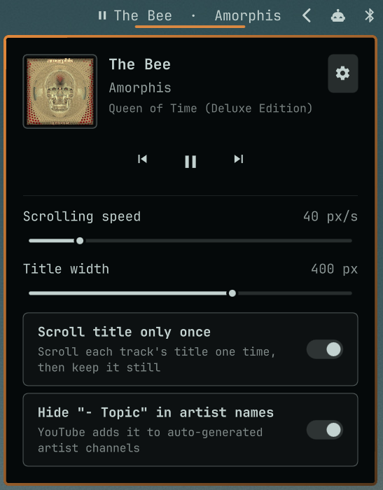

# Calm Media for Omarchy

A now-playing bar widget for the [Omarchy](https://omarchy.org) shell. It is a
clone of Omarchy's built-in media plugin with a settings section for the
scrolling title.

It is meant as a calmer version of the media plugin: the title can scroll once
per track and then sit still, new titles fade in, and you choose how fast and
how wide the scrolling is. Less visually disturbing in the corner of your eye,
unless you set the scroll speed very high. :-)



## Features

- Play/pause glyph and a scrolling "title · artist" label in the bar.
- Popup with album art, transport controls, and a source list when several
  players are running.
- Settings, behind the gear button in the popup:
  - **Scrolling speed** — 10 to 200 px/s (default 40).
  - **Title width** — 60 to 600 px (default 180).
  - **Scroll title only once** — one pass per track, then the title stays still.
  - **Hide "- Topic" in artist names** — YouTube's auto-generated artist
    channels report the artist as "Artist - Topic"; on by default.
  - **Load cover art from the internet** — off by default; see
    [Cover art and network access](#cover-art-and-network-access).

## Controls

| Input          | Action                |
| -------------- | --------------------- |
| Left click     | Play / pause          |
| Middle click   | Next track            |
| Right click    | Open the popup        |
| Scroll up/down | Previous / next track |

## Requirements

Omarchy with the Quickshell desktop (`omarchy-shell`). The widget imports the
shell's `qs.Commons` and `qs.Ui` modules. The plugin ships its own MPRIS service
(`Service.qml`), which takes over from the built-in `omarchy.media` one.

## Install

```bash
omarchy plugin add https://github.com/jrosberg/omarchy-media.git --enable
```

Plugins run as unsandboxed code inside the shell, so read the code first.
Enabling this plugin disables the built-in `omarchy.media`, which it replaces.
If the widget does not appear, run `omarchy restart shell`.

## Configuration

The settings are stored on the widget's entry in `~/.config/omarchy/shell.json`
and can be edited there too:

```json
{
  "id": "io.github.jrosberg.media",
  "scrollSpeed": 40,
  "labelWidth": 180,
  "scrollOnce": false,
  "stripTopic": true,
  "remoteArt": false
}
```

## Cover art and network access

The cover art address comes from the media player, so loading it would let a
player make the shell contact any host it names. By default the plugin
therefore only shows covers the player has saved as local files (`file://`),
which is what browsers such as Chrome do, and makes no network requests.

Players that only give a web address for the cover (Spotify, for example) show
a placeholder until you turn on **Load cover art from the internet**. With it
on, `https://` addresses are fetched; plain `http://` and other schemes are
never loaded.

## Uninstall

```bash
omarchy plugin remove io.github.jrosberg.media
omarchy plugin enable omarchy.media
```

## Translations

The plugin's own strings live in `i18n/en.json`. Add a file per Omarchy
language code (`fi.json`, `de.json`, ...) to translate them; missing strings
fall back to English.

## License

MIT. Based on the media plugin that ships with Omarchy; see [LICENSE](LICENSE).
